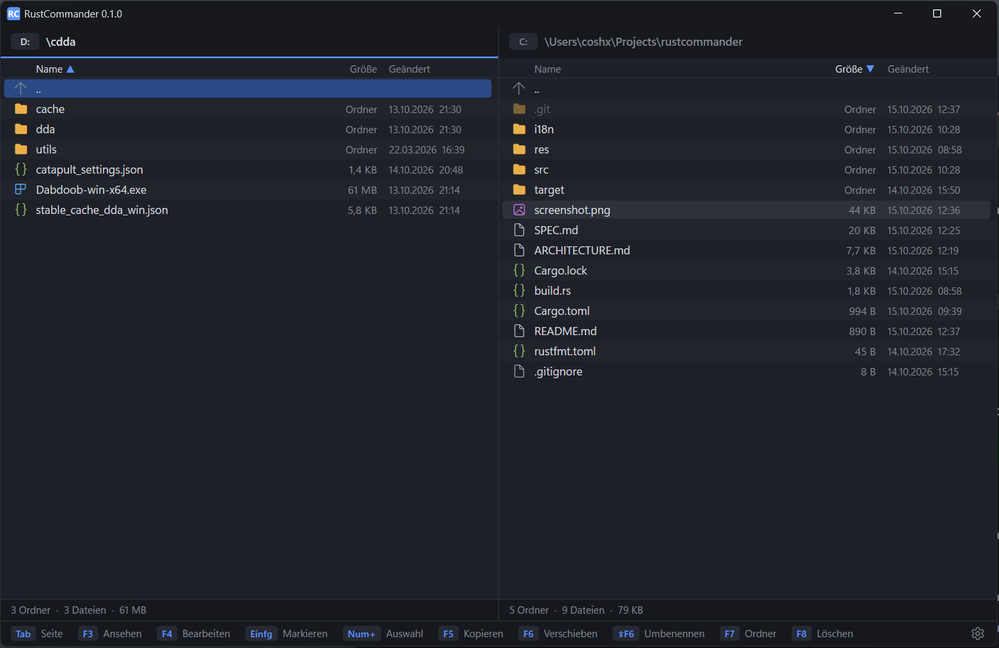

# RustCommander

A Total Commander clone vibed in Rust with a focus on speed and architecture.



## RustCommander vs. Total Commander

| | Total Commander 11.00 (x64) | RustCommander |
|---|---|---|
| Startup: window visible (median of 10) | 185 ms | **17 ms** |
| Startup: ready for input (median of 10) | 186 ms | **44 ms** |
| Size of `C:\Windows` (48.5 GB, 3 runs) | 9.6 s | **1.5 s** |

## Why it's fast

- Win32 + Direct2D, everything custom-drawn; only visible rows are painted.
- Directories are read with `FindFirstFileExW` (large fetch) on background threads; the UI thread
  never waits for the disk.
- One dependency: the `windows` crate.

## Build

```
cargo build --release
```

Windows only. Details: [SPEC.md](SPEC.md) (features, keys, measurements) and
[ARCHITECTURE.md](ARCHITECTURE.md) (code structure).
